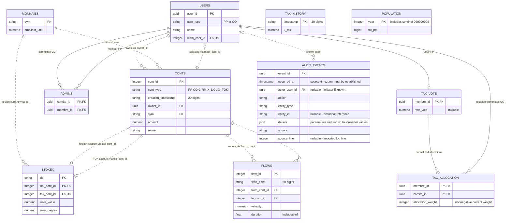

# TOK system ERD

This model was reconstructed from the supplied April 7, 2026 CSV snapshot and April 2 activity log. CSVs do not declare SQL constraints: all PK, FK, uniqueness, types and cardinalities below are inferred or proposed, even where every current row supports them. It describes a logical relational model, not verified database DDL.

The Mermaid source is in [tok-system.mmd](tok-system.mmd). PK means proposed primary key, FK means inferred foreign key, and UK means proposed unique constraint. Multiple PK fields form one composite key. Mermaid solid lines mean identifying relationships; dotted lines mean non-identifying relationships, not confidence levels. `||` means exactly one, `o|` zero or one, and `o{` zero or many. Optional child participation is a conservative model choice, not proof of application rules.

## Diagram

## File-by-file identification

All source filenames below are in `/Users/hivanyf/Desktop/tok projet/tok-system-0_20260407151737461210/`.

| Source file | Rows | Meaning and proposed key |
|---|---:|---|
| 20260407151737461210_users.csv | 57 | Users: 51 people (`PP`) and 6 committees (`CO`). Key: `user_id`. Fields: `user_id`, `user_type`, `name`, `main_cont_id`. |
| 20260407151737461210_conts.csv | 86 | Accounts and snapshot balances. Key: `cont_id`. Fields: `cont_id`, `cont_type`, `creation_timestamp`, `owner_id`, `sym`, `amount`, `name`. |
| 20260407151737461210_admins.csv | 16 | Committee administrator memberships. Composite key: (`comite_id`, `membre_id`). Both fields reference `users.user_id` in different roles. |
| 20260407151737461210_flows.csv | 15 | Time-based flows between accounts. Key: `flow_id`. Fields: `flow_id`, `start_time`, `from_cont_id`, `to_cont_id`, `velocity`, `duration`. These are flow definitions, not a ledger of individual transfers. |
| 20260407151737461210_monnaies.csv | 3 | Currency definitions: CAD, EUR, TOK. Key: `sym`. Other field: `smallest_unit`. |
| 20260407151737461210_population.csv | 128 | Population reference series. Key: `year`. Other field: `tot_pp`. No explicit foreign key to another file. |
| 20260407151737461210_tax_history.csv | 9 | Tax coefficient history. Key: `timestamp`. Other field: `k_tax`. No explicit voter, currency or account reference. |
| 20260407151737461210_tax_vote.csv | 51 | Current per-member rate votes and committee allocation weights. Key: `membre_id`. Other columns: nullable `rate_vote` and six committee UUID columns. |
| history-0_20260402144952310613-20260402205834523123.txt | 6 events | Activity log with a version header. Provides behavioral evidence, not a CSV entity table. |
| 20260407151737461210_stokex.csv (additional discovery) | 11 | Exchange configurations pairing foreign-currency accounts with TOK accounts. Fields: `dol`, `dol_cont_id`, `tok_cont_id`, `user_value`, `user_degree`. Proposed key: `dol_cont_id`; `tok_cont_id` is also unique in this snapshot. This file was found alongside the requested files. |

## Relationships and evidence

| Child field | Parent field | Findings |
|---|---|---|
| `conts.owner_id` | `users.user_id` | All 86 accounts have a matching owner. A user may own multiple accounts. |
| `users.main_cont_id` | `conts.cont_id` | All 57 users select a distinct existing account, and each selected account belongs to that user. This is a separate relationship from ownership. |
| `conts.sym` | `monnaies.sym` | All 86 account currencies match. |
| `flows.from_cont_id` | `conts.cont_id` | All 15 source references match. |
| `flows.to_cont_id` | `conts.cont_id` | All 15 destination references match. |
| `admins.comite_id` | `users.user_id` | Every referenced user has type `CO`. |
| `admins.membre_id` | `users.user_id` | Every referenced user has type `PP`. |
| `tax_vote.membre_id` | `users.user_id` | All 51 references match people of type `PP`. |
| Six UUID column headers in `tax_vote` | `users.user_id` | All six identify committees of type `CO`. These are implicit relationships encoded in headers. |
| `stokex.dol` | `monnaies.sym` | All 11 values match currencies. |
| `stokex.dol_cont_id` | `conts.cont_id` | All 11 references match accounts denominated in the corresponding `dol`. |
| `stokex.tok_cont_id` | `conts.cont_id` | All 11 references match TOK accounts. Each pair has the same owner. |

The proposed model keeps committees and people in `USERS`, as the export does. `ADMINS` implements a many-to-many relationship between those two user roles. There is no separate committee file.

## Normalizing the votes

The source `tax_vote` is a wide matrix:

`membre_id, rate_vote, <committee UUID 1>, ... , <committee UUID 6>`

The diagram proposes two relational tables:

- `TAX_VOTE(membre_id, rate_vote)` preserves the member's current rate vote.
- `TAX_ALLOCATION(membre_id, comite_id, allocation_weight)` converts each committee column into rows. Its key is the member/committee pair. This entity and the field name `allocation_weight` are proposed, not present as a separate source file.

A lossless unpivot produces 306 allocation rows (51 members × 6 committees), including zero weights. Every member's weights sum to 1000 in this snapshot. This supports interpreting the numbers as allocation weights, but does not establish their formal unit or a permanent business rule. Keep all zero rows unless application semantics confirm that an absent row means zero.

41 rate votes are blank. Preserve these as null, distinct from the explicit zero votes. Do not constrain `rate_vote` to 0–100 without checking application semantics; the source contains a value above 100.

## What the activity log establishes

The log identifies TOK SYSTEM VERSION 2.0 and records `load`, `start_new_flow`, two `set_tax_rate_vote` calls, `add_new_comite`, and `remove_user`. Its contents were treated as data, not instructions to execute.

- Flow arguments refer to accounts using `creation_timestamp-cont_id`, whereas the snapshot flow table uses `cont_id` alone. `cont_id` is unique in the snapshot, but durable identity across account deletion/reuse or systems needs confirmation.
- A rate vote is set and then reset to `nan`, consistent with nullable votes.
- A committee is created with two members and then removed. The removed committee is absent from the later snapshot, so log references cannot all be required foreign keys to current users.
- The two vote event timestamps exactly match entries in `tax_history`. This suggests vote changes can trigger coefficient updates, but there is no persistent event ID or member FK in `tax_history` establishing a relational join.

The ERD now includes `AUDIT_EVENTS` as a new design for storing activity history. The source log remains evidence, not an existing database table. Population and tax history remain standalone entities because no explicit foreign keys connect them to the other files.

## Added table designs

These definitions extend the logical ERD. No database has been provisioned, no SQL migration has been executed, and no source records have been uploaded to this repository.

### TAX_ALLOCATION

One row stores one member's current allocation to one committee. This replaces committee UUID columns in the original vote matrix; it does not replace `TAX_VOTE.rate_vote`.

| Field | Type | Required | Key / rule |
|---|---|---|---|
| `membre_id` | UUID | Yes | Composite PK; FK to `TAX_VOTE.membre_id`, which references a `USERS` member |
| `comite_id` | UUID | Yes | Composite PK; FK to `USERS.user_id`, restricted to committee type `CO` |
| `allocation_weight` | Integer | Yes | Nonnegative current weight; explicit zero is preserved |

The pair `(membre_id, comite_id)` must be unique. Membership in `TAX_VOTE` requires a person of type `PP`; role constraints need application validation or database triggers beyond ordinary foreign keys. Proposed deletion behavior is RESTRICT for both parents, so removing a committee or voter requires an explicit allocation decision rather than silently deleting allocations.

Import by unpivoting all six committee columns into 306 rows. Keep the 51 current rate-vote rows separately, preserving their nulls. A total weight of 1000 per member is observed, but remains a business rule to confirm, not a declared database constraint. If adopted, validate the complete member distribution within one transaction, not each row independently. Do not impose a 1000 maximum or convert weights into percentages until their semantics are confirmed.

When a distribution changes, update its rows and append one `tax_allocation_changed` audit event in the same transaction. Use `entity_type = tax_allocation` and the member UUID as `entity_id` to identify the whole distribution; store committee IDs and old/new weights in `details`. This keeps the composite row keys explicit in the event details.

### AUDIT_EVENTS

One row records an action. This is an append-only history, separate from current entity state and from a financial ledger.

| Field | Type | Required | Key / rule |
|---|---|---|---|
| `event_id` | UUID | Yes | PK; assigned by the application or importer |
| `occurred_at` | Timestamp | Yes | Event time with microsecond precision; establish timezone handling before implementation |
| `actor_user_id` | UUID | No | FK to `USERS.user_id`; the initiator, not automatically the affected member |
| `action` | Text | Yes | Explicit action name, such as `tax_vote_changed` |
| `entity_type` | Text | Yes | Target kind, such as `tax_vote`, `user`, `flow`, or `system` |
| `entity_id` | Text | No | Historical target identifier; no FK to a live target table |
| `details` | JSON object | Yes | Known parameters, related IDs, before/after values when available, and source evidence |
| `source` | Text | Yes | Application identifier or original imported filename |
| `source_line` | Integer | No | Positive physical line number in an imported log |

Each event has zero or one known actor; each user may initiate many events. The actor FK uses RESTRICT on deletion: retain/deactivate users with attributed events rather than deleting them or rewriting history. `entity_id` deliberately has no FK because its target may have been deleted, may use a composite identifier, or may be outside the current snapshot. It is not interchangeable with `actor_user_id`.

For imported lines, use a unique `(source, source_line)` pair to prevent duplicate imports; the importer must ensure source filenames identify immutable source files. Application events have a null `source_line` and are identified by `event_id`. Useful indexes are `occurred_at`, `(entity_type, entity_id, occurred_at)` and `(actor_user_id, occurred_at)`.

Normal application access should permit insertion and reading but not updating or deleting audit rows. Corrections should be new events referring to the earlier `event_id`. Write a state change and its event in one database transaction. These are implementation requirements, not protections supplied by Mermaid itself.

### Importing the existing activity log

The six commands become six events; the version header is metadata rather than a seventh event. Preserve the original command, timestamp text and version in `details`. The log does not identify the initiating actor, so all imported `actor_user_id` values must remain null. Do not infer success, missing previous values, or an unrecorded flow ID from a command alone.

| Logged command | Suggested action | Target and details |
|---|---|---|
| `load` | `system_load_requested` | System target; retain the supplied system argument |
| `start_new_flow` | `flow_start_requested` | Flow target with null ID; preserve both account references and numeric arguments without guessing units |
| `set_tax_rate_vote` (two entries) | `tax_vote_change_requested` | Affected member ID; preserve the requested vote value |
| `add_new_comite` | `committee_create_requested` | Committee ID; preserve the supplied name and member list |
| `remove_user` | `user_remove_requested` | Removed user ID; retain the other argument without inventing its role |

The `requested` action names distinguish logged commands from verified completed changes. New application events written atomically after successful changes can use completed-action names such as `tax_vote_changed`.

Convert `nan` to JSON null while preserving the original token in the raw command. The log supplies no timezone; do not label imported times as UTC without confirmation. A source timestamp can be staged as a timezone-unspecified timestamp until the original timezone is established. The text log alone is not a complete replay history or a record of every financial movement.

## Implementation details to confirm

- Twenty-digit times appear to use `YYYYMMDDHHMMSSffffff`. Preserve as text or parse to microsecond timestamps; the source does not specify a timezone. Do not store them in floating-point numbers or signed 64-bit integers.
- `duration` includes `inf`. A database implementation must support infinity or explicitly map it to an unlimited-duration representation. The units of `duration` and `velocity` are not declared in these files.
- Population includes negative years, year zero and `999999999`, which appears to be a sentinel. Store the original year as an integer and confirm sentinel semantics before treating it as an ordinary date.
- Account type counts: `PP` 51, `CO` 6, `G` 6, `RM` 1, `X_DOL` 11, `X_TOK` 11. Personal/committee and exchange roles are supported by names and joins; the exact application definitions of all codes still need confirmation.
- Account balance precision exceeds the currencies' `smallest_unit` in the export. Preserve source precision for reconstruction; determine rounding rules separately.
- Enforce main-account ownership in addition to the simple account FK if implementing this design. A foreign key on `main_cont_id` alone would allow selecting another user's account. The mutual account/user references also require an appropriate insert order or deferred constraints.
- Role restrictions (`CO` for committees and `PP` for members) need additional constraints or application validation beyond a simple FK to `USERS`.
- Exchange keys and one-to-one account participation are proposed from observed uniqueness. Confirm whether account reuse in multiple exchange configurations is allowed before enforcing uniqueness.
- Flows 11 and 12 have identical non-ID fields. They remain separate records because their IDs differ; do not deduplicate automatically.

No source files were modified.
